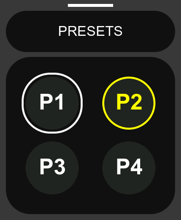
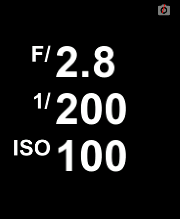
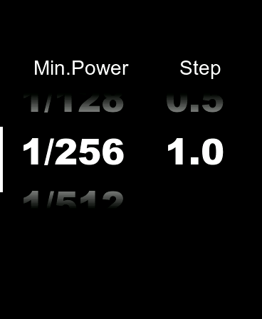
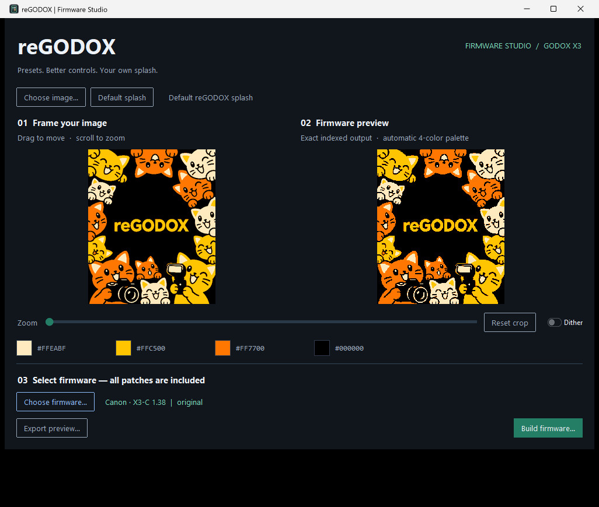
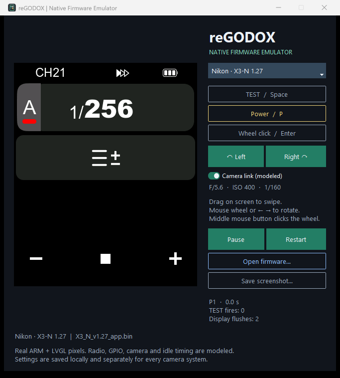

<p align="center"></p>

<p align="center"><strong>English</strong> · <a href="README.ru.md">Русский</a></p>

# reGODOX

**reGODOX is a project that modifies the original Godox firmware for
X3-series wireless flash triggers.**

Supported models: **X3-C (Canon), X3-N (Nikon), X3-S (Sony),
X3-F (Fujifilm), X3-O (Olympus / Panasonic), and X3-L (Leica)**.
Exact supported firmware versions are listed below.

## What the project adds

1. **Settings presets — two to four.** Each preset stores group settings,
   channel, and ID. Select a preset in the drawer opened by swiping
   **up from the bottom**, or cycle presets by holding the **TEST** button.
2. **More STEP options.** In addition to the stock **0.1 and 0.3** options,
   **0.5 and 1.0** are available for larger manual power and TTL compensation adjustments.
3. **A live camera info panel — Canon and Nikon.** Displays aperture,
   shutter speed, and ISO. When the display dims in standby, the panel opens
   automatically and updates as new camera data arrives. You can also open
   it at any time by swiping **right from the left edge of the screen**.
4. **A new startup splash.** Keep the reGODOX cats or use your own picture
   with the included crop and preview editor.

The project includes ready-to-use firmware, a desktop utility that applies
all modifications and edits the splash, and a device UI emulator.

**Unofficial, experimental firmware modifications.** Select the exact camera
system and version below. The desktop apps create files; they do not flash a device.

## Get started

Open this repository's **Releases** page and download:

| Download | Contents |
|---|---|
| `reGODOX-Windows-Bundle.zip` | Both portable apps, all six firmware builds, documentation and checksums |
| `reGODOX-Firmware-Studio.exe` | Firmware patcher and splash editor; Python installation unnecessary |
| `reGODOX-Emulator.exe` | Native UI emulator with six supported original images bundled |
| `reGODOX-Firmware.zip` | Ready-to-use firmware with the default cat splash |
| `SHA256SUMS` | SHA-256 checksums for release assets |

1. Launch **Firmware Studio** and choose the supported original `.bin` for your X3.
2. Keep the default artwork or drop in a picture. Drag to frame it, scroll to zoom,
   and inspect the exact four-color output. Dithering is optional.
3. Click **Build firmware…** and save a new file. **Every reGODOX patch is included**;
   your original is preserved.
4. Inspect the result in the emulator. Install the matching camera-system build
   with the vendor's updater using its normal procedure.

Outputs follow `regodox_<original filename>`, e.g. `regodox_X3_C_v1.38_app.bin`.
Renaming a file does not change its camera system. Keep your original for recovery.

## Screenshots and controls

| Presets | Camera exposure | STEP settings |
|:---:|:---:|:---:|
|  |  |  |
| Four stored banks | Large values, connection status | 0.1 / 0.3 / 0.5 / 1.0 |

- **Presets:** hold TEST for **0.5 seconds**. In the drawer, touch or turn/click
  the wheel to select; selection closes it. Short Power closes without selecting.
  The header shows **P1–P4**; confirmation lasts one second. Native TEST flash
  behavior is retained. Switching is blocked in settings menus.
- **Persistence:** presets survive power cycles and also store modeling light
  and sound. Choose the visible preset count in settings; hidden banks are retained.
- **Camera info:** start the swipe within the leftmost **16 pixels**, below the
  header. Swipe back or short Power to close. Automatic display, **CamLCD**, is
  On by default; disable it with **CamLCD → Off**. During automatic display,
  touch only dismisses the panel; buttons and the wheel also perform their normal action.
- **Splash:** full-screen **368 × 448**, four colors chosen from your image.
  The preview shows the exact result encoded into the firmware.

## Exact supported versions

| Model | System | Original input | Presets / STEP / splash / emulator | Exposure / CamLCD |
|---|---|---|:---:|---|
| X3-C | Canon | `X3_C_v1.38_app.bin` | ✓ | Yes; On by default |
| X3-N | Nikon | `X3_N_v1.27_app.bin` | ✓ | Yes; On by default |
| X3-S | Sony | `X3_S_v1.25_app.bin` | ✓ | Unavailable; Off, menu hidden |
| X3-F | Fujifilm | `X3_F_v1.21_app.bin` | ✓ | Unavailable; Off, menu hidden |
| X3-O | Olympus / Panasonic | `X3_O_v1.09_APP.bin` | ✓ | Unavailable; Off, menu hidden |
| X3-L | Leica | `X3_L_v1.11_app.bin` | ✓ | Unavailable; Off, menu hidden |

Sony/Fujifilm/Olympus/Leica stock secondary firmware sends placeholder exposure
codes. reGODOX suppresses them; the manually opened info panel shows dashes.
Other versions are rejected by hash and byte checks. File names alone are insufficient.

## Firmware Studio



Dark **ttkbootstrap** UI; native Windows picture/BIN drag-and-drop; EXIF-aware
framing; pan, zoom and reset; adaptive four-color palette; dithering; swatches;
PNG preview export; model detection and atomic output. A firmware created by
this release can be reopened to replace its splash. Unknown firmware and
modified executable code are rejected.

## Native firmware emulator



Select any supported system or open an original/patched BIN. Original images
are patched in memory. Real Thumb firmware and LVGL render the display.

| Control | Input |
|---|---|
| Touch / swipe | Left mouse button; drag on the display |
| Encoder | Mouse wheel, left/right arrows, or Left / Right buttons |
| Encoder click | Enter, middle mouse button, or Wheel click |
| TEST | Hold Space or TEST |
| Power | P or Power; press to restart after virtual power-off |
| Capture | Save screenshot exports native 368 × 448 pixels |

The modeled camera supplies **F/5.6, ISO 400, 1/160** on Canon/Nikon. The link
toggle exercises the firmware parser; it does not connect to a physical camera.
Per-model settings live in `%LOCALAPPDATA%/regodox/emulator/flash-<model>.bin`.
Restart preserves them. Both desktop apps use English.

Hardware boundaries and timing are modeled. This is **not cycle accurate** and
does not establish physical TTL, HSS, radio or electrical compatibility. The
active-camera-at-startup GPIO correction needs hardware confirmation.

## Run from source

Install [uv](https://docs.astral.sh/uv/) and Python 3.12 with Tk. In the project root:

```powershell
uv sync --frozen --all-groups
uv run regodox-gui
uv run --group emulator regodox-emulator
```

The project uses its own `.venv` and committed `uv.lock`. For Firmware Studio
alone: `uv sync --frozen --no-default-groups`, then
`uv run --no-default-groups regodox-gui`.

CLI commands use the same patch engine:

```powershell
uv run regodox profiles
uv run regodox inspect firmware/original/X3_C_v1.38_app.bin
uv run regodox patch firmware/original/X3_C_v1.38_app.bin -o dist/custom.bin --splash photo.jpg
uv run regodox build-all --output-dir dist/firmware
uv run --all-groups pytest -q
uv run --all-groups ruff check src tests tools
```

## Build and publish

On Windows:

```powershell
uv run --frozen --no-default-groups python tools/build_windows.py --app both
uv run --frozen --no-default-groups python tools/smoke_executables.py
uv run --frozen regodox build-all --output-dir dist/firmware
uv run --frozen --no-default-groups python tools/package_release.py
```

Each app builds in a **separate uv environment** with frozen dependencies, disabled
system/user site packages and isolated Python. The patcher omits Unicorn/Capstone.
The emulator clears CFG opt-in in its own unsigned PE header for
[Unicorn compatibility](https://github.com/unicorn-engine/unicorn/issues/2281);
Windows settings are untouched. Actual EXEs must pass smoke tests before packaging.

[GitHub Actions](.github/workflows/build.yml) tests source and native behavior,
builds all firmware and both EXEs, and assembles `dist/release/`. Branch/PR builds
upload artifacts. Pushing a **`v*` tag** publishes a GitHub Release with both EXEs,
the firmware ZIP, combined Windows bundle, both READMEs, license notices and
`SHA256SUMS`. No manual attachments needed:

```powershell
git tag v0.1.0
git push origin v0.1.0
```

## How it is built

This is a **version-pinned binary patch project**, not a rebuild of the whole
proprietary firmware. Precompiled C/Thumb extensions and byte patches are applied
with original-byte assertions. Audit sources and maps: [`firmware/src`](firmware/src/README.md).
Recipes are bundled with the apps. Default outputs reproduce recorded SHA-256
exactly; the protected tail and secondary firmware remain byte-identical.

See [`AGENTS.md`](AGENTS.md) for working rules and the repository map, and
[`docs/development.md`](docs/development.md) for technical details.

## License

Project code: MIT. Original Godox firmware and retained vendor bytes remain
proprietary and are **not** relicensed. See [`LICENSE`](LICENSE) and
[`THIRD_PARTY_NOTICES.md`](THIRD_PARTY_NOTICES.md). reGODOX is independent of Godox
and camera manufacturers.
