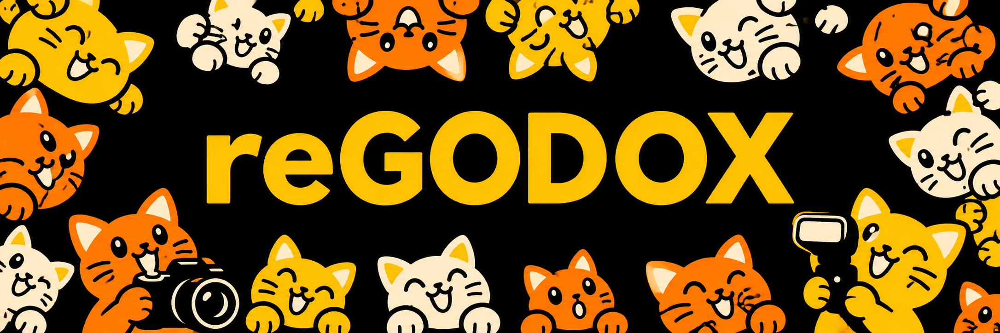
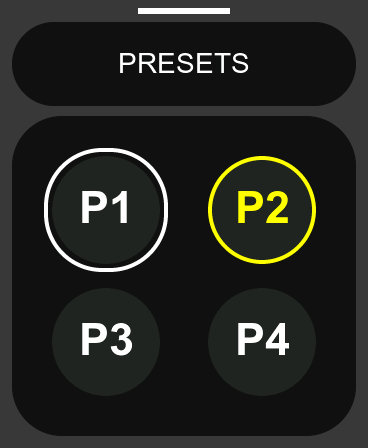
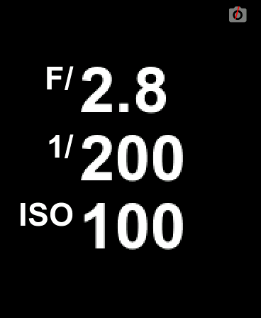
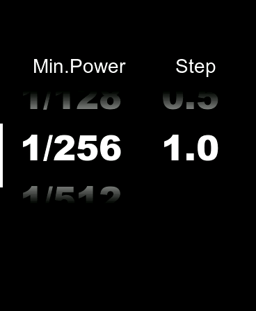
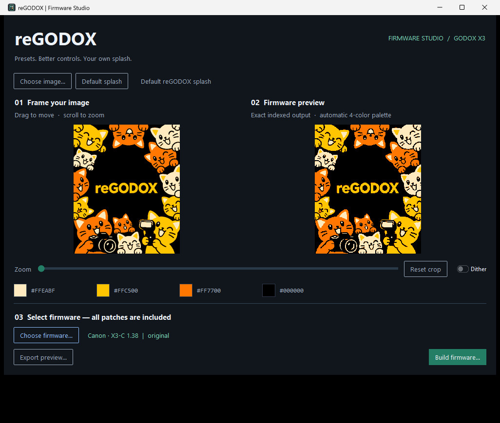
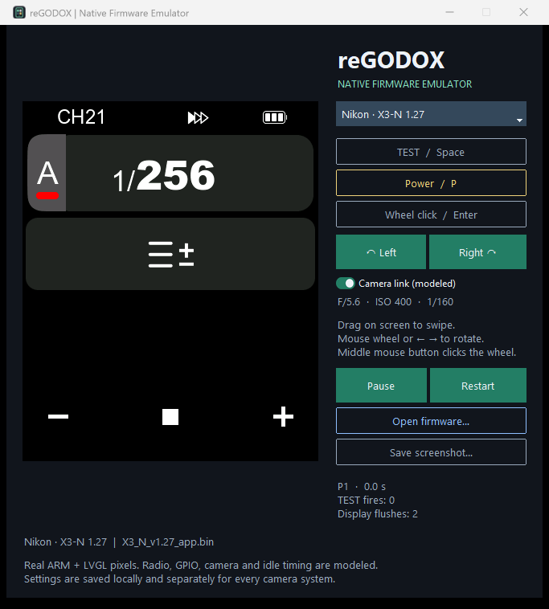

<p align="center"></p>

<p align="center"><a href="README.md">English</a> · <strong>Русский</strong></p>

# reGODOX

**reGODOX — проект по модификации оригинальной прошивки Godox для
радиосинхронизаторов серии X3.**

Поддерживаемые модели: **X3-C (Canon), X3-N (Nikon), X3-S (Sony),
X3-F (Fujifilm), X3-O (Olympus / Panasonic) и X3-L (Leica)**.
Точные версии прошивок приведены ниже.

## Что добавляет проект

1. **Пресеты настроек — от двух до четырёх.** Каждый пресет хранит настройки
   групп, канала и ID. Выбрать пресет можно в шторке, открываемой свайпом
   снизу вверх, или переключить долгим удержанием кнопки **TEST**.
2. **Дополнительные значения STEP.** Помимо штатных **0.1 и 0.3** доступны
   **0.5 и 1.0** — для изменения ручной мощности и коррекции TTL более крупными шагами.
3. **Инфопанель с текущими настройками камеры — для Canon и Nikon.**
   Показывает диафрагму, выдержку и ISO. В режиме ожидания, когда экран тускнеет,
   панель появляется автоматически, а значения обновляются при поступлении
   новых данных от камеры. Её также можно в любой момент открыть свайпом
   **слева направо от левого края экрана**.
4. **Новая заставка при включении.** Можно оставить изображение reGODOX
   с котиками или поставить своё через редактор с кадрированием и предпросмотром.

В проект входят готовые прошивки, утилита для применения всех модификаций
и настройки заставки, а также эмулятор интерфейса устройства.

**Неофициальная экспериментальная модификация.** Поддерживаются конкретные модели
и версии из таблицы ниже. Утилиты создают файлы и не прошивают устройство.

## Начало работы

На странице **Releases** этого репозитория доступны:

| Файл | Что внутри |
|---|---|
| `reGODOX-Windows-Bundle.zip` | Обе утилиты, шесть прошивок, документация и контрольные суммы |
| `reGODOX-Firmware-Studio.exe` | Патчер и редактор заставки; установка Python не требуется |
| `reGODOX-Emulator.exe` | Эмулятор с шестью поддерживаемыми оригиналами |
| `reGODOX-Firmware.zip` | Готовые прошивки с заставкой с котиками |
| `SHA256SUMS` | SHA-256 файлов релиза |

1. Откройте **Firmware Studio** и выберите подходящий оригинальный `.bin`.
2. Оставьте котиков или перетащите свою картинку. Мышь меняет кадрирование,
   колесо — масштаб. Справа виден точный результат в четырёх цветах.
   По желанию включите **Dither**.
3. Нажмите **Build firmware…** и сохраните новый файл. Применяются **все исправления
   reGODOX**. Исходный файл остаётся целым.
4. Откройте результат в эмуляторе. Для установки используйте штатный прошивальщик
   и файл именно для своей системы камеры.

Название результата: `regodox_<оригинальное имя>`, например
`regodox_X3_C_v1.38_app.bin`. Переименование не превращает Nikon-прошивку в Canon.
Сохраните оригинал для возврата к штатному поведению.

## Скриншоты и управление

| Пресеты | Параметры камеры | Шаг настройки |
|:---:|:---:|:---:|
|  |  |  |
| Четыре независимых банка | Крупно и лаконично | 0.1 / 0.3 / 0.5 / 1.0 |

- **Пресеты:** удержание TEST — **0,5 секунды**. В шторке доступны касание
  и колесо с кликом; выбор сразу закрывает её. Короткий Power закрывает без выбора.
  Сверху виден **P1–P4**, подтверждение держится одну секунду. Штатное срабатывание
  TEST сохранено; в меню настроек переключение заблокировано.
- **Сохранение:** пресеты переживают выключение и дополнительно хранят пилотный
  свет и звук. Число видимых пресетов выбирается в настройках; скрытые не стираются.
- **Инфопанель:** свайп начинается в левых **16 пикселях**, ниже верхней строки.
  Обратный свайп или короткий Power закрывает панель. Автопоказ **CamLCD** включён
  по умолчанию; его можно отключить через **CamLCD → Off**. При автопоказе касание
  только закрывает панель, а кнопки и колесо также выполняют штатное действие.
- **Заставка:** весь экран **368 × 448**, четыре цвета с подбором по изображению.
  Предпросмотр показывает точный результат, который будет записан в прошивку.

## Поддерживаемые версии

| Модель | Система | Оригинальный файл | Пресеты / STEP / заставка / эмулятор | Параметры камеры / CamLCD |
|---|---|---|:---:|---|
| X3-C | Canon | `X3_C_v1.38_app.bin` | ✓ | Есть; включён по умолчанию |
| X3-N | Nikon | `X3_N_v1.27_app.bin` | ✓ | Есть; включён по умолчанию |
| X3-S | Sony | `X3_S_v1.25_app.bin` | ✓ | Нет; выключен, пункт скрыт |
| X3-F | Fujifilm | `X3_F_v1.21_app.bin` | ✓ | Нет; выключен, пункт скрыт |
| X3-O | Olympus / Panasonic | `X3_O_v1.09_APP.bin` | ✓ | Нет; выключен, пункт скрыт |
| X3-L | Leica | `X3_L_v1.11_app.bin` | ✓ | Нет; выключен, пункт скрыт |

У Sony/Fujifilm/Olympus/Leica второй контроллер передаёт заглушки вместо
экспопараметров. reGODOX подавляет их; вручную открытый инфоэкран показывает
прочерки. Другие версии отклоняются по хешам и проверкам байтов.
Одного совпадения имени файла недостаточно.

## Firmware Studio



Тёмный интерфейс на **ttkbootstrap**, нативное перетаскивание картинок и BIN в
Windows, учёт ориентации EXIF, кадрирование, масштаб, адаптивная палитра, дизеринг,
образцы цветов и экспорт в PNG. Определение модели и атомарное сохранение.
Уже собранную этой версией reGODOX-прошивку можно открыть для замены заставки;
неизвестные файлы и изменённый исполняемый код отклоняются.

## Эмулятор настоящего интерфейса



Обе утилиты на **английском языке**. Эмулятор принимает все поддерживаемые
системы и оригинальные/модифицированные BIN. Оригинал патчится в памяти.
Картинку строит настоящий Thumb-код прошивки и LVGL.

| Действие | Управление |
|---|---|
| Касание / свайп | Левая кнопка мыши и перетаскивание по экрану |
| Колесо | Колесо мыши, стрелки влево/вправо или Left / Right |
| Клик колеса | Enter, средняя кнопка мыши или Wheel click |
| TEST | Удержание пробела или TEST |
| Питание | P или Power; после виртуального выключения включает заново |
| Снимок | Save screenshot сохраняет исходные пиксели 368 × 448 |

Для Canon/Nikon моделируются данные **F/5.6, ISO 400, 1/160**. Переключатель связи
проверяет штатный парсер; подключения к реальной камере нет. Настройки моделей
хранятся отдельно в `%LOCALAPPDATA%/regodox/emulator/flash-<модель>.bin`.
Перезапуск их сохраняет.

Эмулятор моделирует границы аппаратуры и время, но не является потактовой моделью
МК. Он не подтверждает работу физического TTL, HSS, радио или электрической шины.
Исправление связи при запуске рядом с уже активной камерой требует проверки на железе.

## Запуск из исходников

Установите [uv](https://docs.astral.sh/uv/) и Python 3.12 с Tk. В каталоге проекта:

```powershell
uv sync --frozen --all-groups
uv run regodox-gui
uv run --group emulator regodox-emulator
```

Используются собственный `.venv` и закреплённые зависимости из `uv.lock`.
Только редактор: `uv sync --frozen --no-default-groups`, затем
`uv run --no-default-groups regodox-gui`.

CLI использует тот же механизм патчей:

```powershell
uv run regodox profiles
uv run regodox inspect firmware/original/X3_C_v1.38_app.bin
uv run regodox patch firmware/original/X3_C_v1.38_app.bin -o dist/custom.bin --splash photo.jpg
uv run regodox build-all --output-dir dist/firmware
uv run --all-groups pytest -q
uv run --all-groups ruff check src tests tools
```

## Сборка и релизы

В Windows:

```powershell
uv run --frozen --no-default-groups python tools/build_windows.py --app both
uv run --frozen --no-default-groups python tools/smoke_executables.py
uv run --frozen regodox build-all --output-dir dist/firmware
uv run --frozen --no-default-groups python tools/package_release.py
```

Каждая утилита собирается в **отдельном окружении uv**, с фиксированными
зависимостями, без системных и пользовательских пакетов. Патчер не включает
Unicorn и Capstone. Для совместимости с
[Unicorn](https://github.com/unicorn-engine/unicorn/issues/2281) у неподписанной
EXE эмулятора снимается флаг CFG в её PE-заголовке; настройки Windows не меняются.
Перед упаковкой запускаются и проверяются обе реальные EXE.

[GitHub Actions](.github/workflows/build.yml) проверяет код и поведение прошивок,
собирает все BIN и обе EXE, затем готовит `dist/release/`. Для веток и PR доступны
артефакты. Для ручной публикации откройте **Actions → Build and release →
Run workflow**, поставьте галочку **Publish GitHub Release** и запустите workflow.
После успешных проверок и сборок появится релиз `build-<номер запуска>` для
выбранного коммита. Без галочки будут собраны только артефакты.

**Push тега `v*` также автоматически публикует GitHub Release**: обе EXE,
архив прошивок, общий Windows-комплект, два README, лицензии и `SHA256SUMS`.
Прикреплять файлы вручную не нужно:

```powershell
git tag v0.1.0
git push origin v0.1.0
```

## Устройство проекта

Это **патчи конкретных версий BIN**, а не пересборка всей закрытой прошивки Godox.
Собранные расширения на C/Thumb и замены байтов применяются с проверкой исходных
данных. Исходники и карты адресов: [`firmware/src`](firmware/src/README.md).
Рецепты входят в поставку утилит. Стандартные сборки точно воспроизводят
записанные SHA-256. Защищённый хвост и прошивка второго контроллера сохраняются побайтно.

Правила работы и карта проекта: [`AGENTS.md`](AGENTS.md).
Технические детали: [`docs/development.md`](docs/development.md).

## Лицензия

Код проекта — MIT. Оригинальная прошивка Godox и сохранённые байты производителя
остаются проприетарными и не переходят под MIT. Подробности:
[`LICENSE`](LICENSE), [`THIRD_PARTY_NOTICES.md`](THIRD_PARTY_NOTICES.md).
Проект не связан с Godox и производителями камер.
